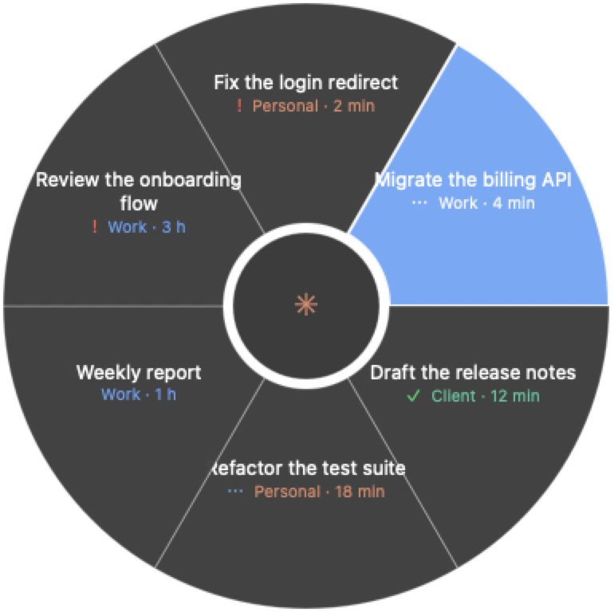

# Claude Tabs

Browser-style tabs for several **Claude Desktop** accounts on macOS: one tab per
account, all in one window, with live counters of your Claude Code sessions.

```
┌──────────────────────────────────────────────────────────────────────┐
│ 1  Personal  ⋯2 ✓1 │ 2  Work         !1 │ 3  Client · closed │ !1 · 3 h │ + │
├──────────────────────────────────────────────────────────────────────┤
│                                                                      │
│              the Claude Desktop window of the active tab             │
│                                                                      │
```

Claude Desktop signs in to one account at a time. Claude Tabs runs one Claude
instance per account, each with its own data folder (so its own sign-in), and
stacks their windows under a tab bar drawn by [Hammerspoon](https://www.hammerspoon.org).

> Unofficial. Not affiliated with or endorsed by Anthropic. It relies on
> Claude Desktop details that are not a public API (data folder layout, session
> files, log lines) and may need fixes after a Claude update.

## Features

- **One tab per account**, any number of accounts. Click a tab, `⌃⌥1…9`, or
  `⌘ + scroll` (mouse or trackpad) to switch. A closed account starts on click.
- **Session badges on each tab**, for that account's Code sessions:
  `⋯` working (agents left running in the background included) · `✓` done and
  not opened yet · `!` waiting for you: a permission or question in the middle
  of a turn, or a turn that ended on something only you can give (a choice, an
  answer: Claude says so in the summary it writes after each turn). A done
  session leaves the count when you open it.
- **Find them**: click a tab's badges for its sessions, with what each one
  waits for; click one to open it right there, in its account. The red
  `! 2 · 3 h` button before `+` appears when sessions wait for you (2, the
  oldest for 3 h): it lists them across all accounts, oldest first, then the
  working and done ones; click a section's title to fold it. `⌃⌥N` opens the
  next one waiting.
  ⌥-click one you won't answer now to drop it until its next turn. The same
  list sits in the menu bar (✳︎).
- **Session ring**: `⌃⌥⇧⌘R` (or a mouse button) opens your latest sessions of
  all accounts in a ring around the pointer; flick toward one to open it.
  [More](#session-ring).
- **Plan usage on each tab**: the account's weekly usage and when it resets
  (`Team · 12% · ↻ Fri 9:00`, or `↻ ~Fri` while the hour is not known yet),
  and a gauge under the tab: the bar is the usage, the tick how much of the
  week has gone by. Orange when you use it faster than the week goes by, red
  when at this pace you would run out before the reset. Dimmed when the
  reading is old. The menus add the countdown and the 5-hour limit.
- **Behaves like one window**: drag the tab bar to move the group to another
  screen; it fills the screen it is on (`autoFill`), and follows the Dock and
  screens being plugged or woken up. `⌃⌥E` moves it to the next screen.
- **Hand a task to another account**: an agent near its account's limit, or
  missing a connector another account has, opens a new session there with a
  brief for you to send. [More](#handing-a-task-to-another-account).
- **`+` button** after the last tab to add an account; **right-click a tab** to
  rename or remove it.
- **Sign-ins land in the right tab**: the browser's "Open Claude" link goes back
  to the tab that started the sign-in, automatically (see below).
- **Launchers**: `~/Applications/Claude Tabs/Claude <Account>.app`, for Spotlight.
- English and French interface.

## Requirements

- macOS, [Claude Desktop](https://claude.ai/download)
- [Hammerspoon](https://www.hammerspoon.org): `brew install --cask hammerspoon`

## Install

```bash
git clone https://github.com/cdussieux/claude-tabs.git
cd claude-tabs
./install.sh
```

Then:

1. Give Hammerspoon **Accessibility** access: System Settings → Privacy &
   Security → Accessibility (it moves and focuses windows).
2. The bar shows one tab: the Claude you already use. Click **`+`**, name the
   new account, and sign in in the window that opens. Repeat for each account.
3. Optional: `~/.hammerspoon/claude-tabs/config.lua` (language, screen,
   shortcuts…). Saving reloads Claude Tabs. The tabs themselves are kept in
   `profiles.json` next to it.

`install.sh` also updates: run it again after a `git pull`. Your `config.lua`
is kept.

## Signing in to another account

Claude's sign-in ends with an "Open Claude" button in your browser, and macOS
sends that `claude://` link to the first Claude instance it finds, not to the
tab you are signing in. Claude Tabs fixes that by itself: just sign in in the
tab's window and click "Open Claude".

How: when a Claude window starts a browser sign-in, Claude writes
`[Auth] Using system browser for: /login/…` in its log. Claude Tabs sees it,
notes which account's window is in front, and for a few minutes makes a tiny
router app the `claude://` handler. The "Open Claude" link reaches the router,
which hands it to Hammerspoon, which sends it to that account's instance only
(an Apple Event addressed to its pid). Claude gets `claude://` links back right
after.

If it ever fails, **`⌃⌥L`** (or right-click → "Sign in to this account") turns
sign-in mode on by hand before you start: Claude then signs in through macOS'
own sign-in sheet, which answers the right instance directly.

## Shortcuts

| | |
|---|---|
| `⌃⌥1` … `⌃⌥9` | go to tab n |
| `⌘ + scroll` | previous / next tab (Claude in front) |
| drag the tab bar | move the group; drop it on a screen to fill that screen |
| `⌃⌥E` | move to the next screen |
| `⌃⌥F`, double-click the bar | fill the screen (with `autoFill = false`: toggle) |
| `+` after the last tab | add an account |
| right-click a tab | sign in, rename, remove |
| `⌃⌥L` | sign-in mode for the current tab, by hand |
| `⌃⌥N` | open the next session waiting for you (any account) |
| click a tab's badges | its sessions; click one to open it |
| `⌃⌥⇧⌘R` (any app) | session ring: your latest sessions around the pointer |

All are configurable in `config.lua`.

## Session ring

<p align="center"></p>

Press `⌃⌥⇧⌘R`, from any app: your 6 latest Code sessions, all accounts mixed,
open in a ring around the pointer. Each slice shows the session's title, its
account in the tab's colour, how long ago it was active, and its state:
`!` waiting for you, `⋯` working, `✓` done and not opened yet. Move toward a
slice, then click (or press the shortcut again) to open that session in its
account; a closed account is started first. Esc, right-click or a click in the
middle closes the ring.

It works best on a mouse button: press it, flick toward a session, press
again.

- **Logitech mice (Logi Options+)**: pick a button (the middle button, a thumb
  button, the gesture button, the MX Master 4's haptic panel…), choose
  *Keyboard shortcut* and press `⌃⌥⇧⌘R`. Set it for *All applications*, not
  only Claude, so the ring opens from anywhere.
- **Logitech G mice (G HUB)**: assign the button the same key combination.
- **Any mouse, with [Karabiner-Elements](https://karabiner-elements.pqrs.org)**
  (free): save this as
  `~/.config/karabiner/assets/complex_modifications/claude-tabs.json`, then in
  Karabiner's settings add the rule (*Complex Modifications > Add rule*) and
  turn on *Modify events* for your mouse (*Devices*):

  ```json
  {
    "title": "Claude Tabs",
    "rules": [{
      "description": "Middle button opens the Claude Tabs session ring",
      "manipulators": [{
        "type": "basic",
        "from": { "pointing_button": "button3" },
        "to": [{ "key_code": "r",
                 "modifiers": ["left_control", "left_option", "left_shift", "left_command"] }]
      }]
    }]
  }
  ```

  The middle button then no longer middle-clicks (opening links in a new tab,
  closing browser tabs). If you use that, take a side button instead:
  `button4` or `button5`.

In `config.lua`: `ringHotkey` changes the shortcut, `ringCount` the number of
sessions, `ring = false` turns it off.

## Handing a task to another account

When one account is close to its limit, or a task needs a connector only
another account has (its Gmail, its Notion…), an agent can pass the task on:

```bash
~/.hammerspoon/claude-tabs/claude-tabs accounts      # accounts, usage, notes
~/.hammerspoon/claude-tabs/claude-tabs handoff --to work --folder ~/code/app "<brief>"
```

The other account opens a new session in that folder with the brief typed in;
you read it and press Enter. `--to auto` picks the account with the most
weekly usage left. The install adds a skill, `claude-tabs-handoff`, so agents
know when to offer it and how to write a brief that stands on its own; the
new session reports back to the one that sent it.

- **Notes for agents**: right-click a tab > *Notes for agents…* and say what
  that account has that the others don't ("work Gmail, Notion"). Agents read
  them in `claude-tabs accounts` to pick the right account.
- **Auto-send**: with `handoffAutoSend = true`, Claude Tabs presses Enter for
  you, but only once the brief is in the message box and has the focus, and
  you have not touched the keyboard or mouse for a second. Otherwise the brief
  stays typed. The agent's brief then becomes your prompt in that account
  without you reading it first: turn it on only if you are fine with that.

## How it works

- **Profiles**: `open -n -a Claude --args --user-data-dir=~/.claude-profiles/<id>`.
  Electron keeps one instance per data folder, so each account is a separate
  app instance with its own sign-in and its own Code sessions list.
- **Tab bar**: a Hammerspoon canvas above the active window. Every tab's window
  is kept at the same frame; switching focuses the right instance.
- **Counters**: Claude Code hooks in `~/.claude/settings.json`
  (`UserPromptSubmit`, `Stop`, `Notification`, `PreToolUse`/`PostToolUse` on
  `AskUserQuestion`) call `hook.sh`, which finds the Claude instance that runs
  the session by walking up its parent processes and tells Hammerspoon
  (`hammerspoon://claude-tabs?...`). Whether you have read a finished session
  comes from Claude Desktop's own session files (`lastFocusedAt`).
- **Session ring**: lists the newest session files of all accounts by date,
  reads only their id, title and dates from the text (decoding a ~200 KB file
  whole is too slow to open at the pointer), and takes each one's state from
  what the tabs show.
- **Sessions**: every 30 s, and when Claude rewrites a session file, Claude
  Tabs also reads the session files of the last 24 h (title, and the summary
  Claude writes after each turn: blocked or not, and what it needs from you),
  and the dates of each session's transcript files in `~/.claude/projects`: a
  background agent whose file was written in the last 3 min is at work. A
  session opens with Claude's own `claude://code/continue?session=…` link,
  sent to its account's instance.

- **Usage**: Claude Desktop saves each usage reading of its account to
  `plan-usage-history.json` in its data folder; Claude Tabs reads that file (no
  network, no credentials). Claude only keeps reading in the background while
  its usage menu (right-click on its menu bar icon) was opened in the last 24 h,
  so when a tab's numbers go stale and you are idle, Claude Tabs opens that
  menu for a moment and closes it. Tab menu > "Refresh usage" does it now.
  The menu gives the time to the reset, rounded down ("Resets 3d"); each
  reading narrows the window, and a drop of the weekly % in the history dates
  the last reset to within minutes (the next one is 7 days later).

- **Hand-off**: `claude-tabs handoff` drops the brief in a file and calls
  `hammerspoon://claude-tabs-handoff`; Claude Tabs sends Claude's own
  `claude://code/new?q=<brief>&folder=<folder>` link to the target account's
  instance (starting it first if it is closed). Messages between sessions
  already work across accounts: all of them share `~/.claude`, where Claude
  Code lists its live sessions.

More detail and the pitfalls met on the way: [docs/how-it-works.md](docs/how-it-works.md).

## Limits

- Only **Code** sessions are counted, not chat conversations.
- A background agent quiet for more than 3 min (a long command) counts as
  stopped until it writes again.
- Usage needs Claude's menu bar icon to be visible (not hidden behind the notch
  or by a menu bar manager). Until the last day before a reset, or a reset
  seen in the history, its time is only known to the day (`~Fri`).
- `~/.claude` (Claude Code settings, transcripts) is shared by all accounts.
- A hand-off brief is at most 14,000 characters, and the new session sees
  nothing of the conversation that sent it.
- macOS only. Thoughts on Linux: [docs/linux.md](docs/linux.md).

## Tests

```bash
scripts/check.sh   # static checks, no running app needed
tests/smoke.sh     # live test of the installed copy (Hammerspoon + one Claude open)
```

## Uninstall

```bash
./uninstall.sh           # keeps your config.lua and tabs (profiles.json)
./uninstall.sh --purge   # removes everything Claude Tabs added
```

Your accounts' data folders (`~/.claude-profiles/…`) are never removed: they
hold your sign-ins and sessions.

## License

MIT
